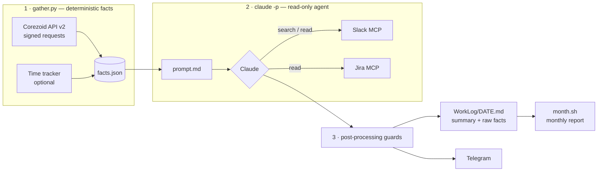

# daily-digest

**An AI agent that writes my daily work report for me.** Every evening it collects what I actually did — Corezoid process changes, time-tracker entries, Slack threads, Jira tickets — links each piece of work to a ticket and sends a short summary to Telegram. At the end of the month it turns the daily digests into a report grouped by day or by ticket.

I built it to automate my own analyst/developer routine: the status report used to take 15–20 minutes of digging through Slack and process history; now it takes zero, and it is more accurate than my memory.

## How it works



1. **Facts first, model second.** `gather.py` collects everything that can be collected deterministically:
   - `cz_changes.py` walks the folder tree of every Corezoid stage in parallel (BFS, 8 threads), keeps objects changed today, then reads each one's history and keeps **only my actions** — with changed node titles, commit count and the time window of my edits;
   - an optional local time tracker adds tasks, meetings and manual entries.
   Each source is isolated: if one fails, the error goes into the JSON and the digest still runs.
2. **The agent links and summarises.** Claude Code runs headless (`claude -p`) with an explicit **read-only tool allowlist** — Slack search/read and Jira read. It finds my Slack threads for the day, pulls ticket mentions from them, reads ticket summaries and attaches every unit of work to a ticket.
3. **Guards after the model.** The shell strips any preamble before the header and leading slashes that Telegram would turn into bot commands; an empty answer fails the run instead of sending an empty message.
4. **Audit trail.** The digest is saved together with the raw facts in a collapsed block, so every claim can be checked. `month.sh` builds the monthly report from these files only, so it never re-queries the sources.

## Prompt design: fighting confident mistakes

The first versions were fluent and wrong: the model linked a process change to a ticket because the names *sounded* similar. The prompt (`prompt.md`) now encodes explicit evidence rules:

- **Link by time, not by name.** A process change belongs to a ticket only if `my_edits_time` overlaps with, or comes right after, the discussion of that ticket. Name similarity is explicitly *not* evidence.
- **A thread owns its work.** If a Slack thread mentions a ticket, all work discussed in it belongs to that ticket — even if someone else posted the link.
- **Uncertain → don't claim.** If the link is uncertain, the process is listed only in the 🔧 line, not under a ticket.
- **One task = one item**, exact process names, no invented ticket numbers.
- **Strict output budget** (≤ 5 words per title, ≤ 4 per result, 3–6 items): the report is read on a phone.

## Example output

> Synthetic example — real digests contain internal data and are never published.

```
🗓 09.11.2026 Mon
• PROJ-1234 Duplicate payment callback — fixed, on QA
• PROJ-1240 KYC status mapping — contract agreed
• PROJ-1251 Retry on provider timeout — in review
• Stage deploy check — done

💬 Callback retries move to a queue next sprint
🔧 payment_callback (PROJ-1234), kyc_status, provider_retry
```

## Setup

Requirements: Python 3.11+, zsh, [Claude Code](https://claude.com/claude-code) with Slack and Atlassian MCP connectors, Corezoid API credentials.

```bash
pip install -r requirements.txt
cp config.example.json config.json     # fill in user, Corezoid stages and user_id, Jira key
printf 'TELEGRAM_TOKEN=...\nTELEGRAM_CHAT_ID=...\n' > ~/.daily-digest.env

./run.sh --no-send             # today, save only
./run.sh 2026-11-06            # a specific day, save + Telegram
./month.sh 2026-11 --tasks     # monthly report grouped by ticket
```

Corezoid credentials are read from the Corezoid CLI config (`~/.corezoid/config.json`): a list of folders with `stage_id`, `corezoid_url`, `api_login`, `api_secret`, `workspace_id`, `project_id`. Schedule `run.sh` with launchd or cron (e.g. weekdays at 19:00). A lock directory prevents a manual run and the scheduler from overlapping.

## Files

| File | Role |
|---|---|
| `gather.py` | Collects facts → JSON |
| `cz_api.py` | Minimal signed Corezoid API v2 client |
| `cz_changes.py` | "What did I change in Corezoid today" across all stages |
| `prompt.md` | Daily agent prompt: steps, linking rules, output format |
| `prompt_month.md`, `prompt_month_tasks.md` | Monthly reports: by day / by ticket |
| `run.sh`, `month.sh` | Orchestration, tool allowlist, guards, saving, sending |
| `send_tg.py` | Telegram sender with 4000-char chunking |
| `settings.py` | Config loader and prompt template renderer |

## Security

- The agent gets **only read tools**; it cannot post to Slack or edit Jira.
- Secrets live outside the repo (`config.json` and `.env` are git-ignored).
- Raw facts stay local in `WorkLog/`.
